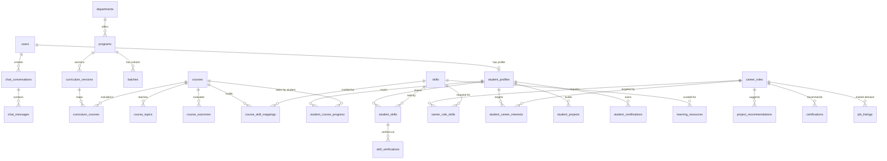

# CourseCompass — Complete System Architecture & Project Documentation (AI Handover Reference)

> **Document Purpose**: This is the single-source-of-truth technical handover specification for CourseCompass. Any AI agent or engineer reading this document will understand the entire application architecture, database schemas, data flows, completed features, role boundaries, API routes, and operational guidelines.

---

## 1. Executive Overview

- **Project Name**: CourseCompass
- **Target Audience**: B.Sc. in Computer Science & Engineering (BCSE) students, faculty, and administration at the **International University of Business Agriculture and Technology (IUBAT)** in Dhaka, Bangladesh.
- **Mission**: A curriculum-intelligence platform that maps student completed coursework to real-world job competencies, visualizes skill gaps against target industry roles, generates actionable semester-by-semester roadmaps, hosts an AI academic mentor (*AI Bhai*), and empowers the CSE Department with student cohort analytics and Course Outcome (CO/PO) governance.
- **Repository URL**: `https://github.com/Ayesha-Rimione/Course-Compass.git`

---

## 2. Tech Stack & Environment Architecture

```
                               ┌───────────────────────────────────────────────────────────┐
                               │                    FRONTEND CLIENT                        │
                               │  - React 19 + TypeScript + Vite                           │
                               │  - TanStack Router + TanStack Query                       │
                               │  - TailwindCSS + Radix UI + Lucide + Recharts             │
                               │  - 3D Vanta.js WebGL (Profile Setup)                      │
                               └─────────────────────────────┬─────────────────────────────┘
                                                             │
                                                             │ HTTP REST Calls (JWT Bearer Token)
                                                             │ (via src/api/client.ts)
                                                             ▼
                               ┌───────────────────────────────────────────────────────────┐
                               │                    FASTAPI BACKEND                        │
                               │  - Python 3.12 + FastAPI + Pydantic v2                    │
                               │  - SQLAlchemy 2.0 ORM + Psycopg2 Engine                   │
                               │  - Pytest (76 Unit Tests)                                 │
                               │  - Role-Based Access Control (STUDENT, ADMIN)             │
                               └─────────────────────────────┬─────────────────────────────┘
                                                             │
                                                             │ Connection Pool (DATABASE_URL)
                                                             ▼
                               ┌───────────────────────────────────────────────────────────┐
                               │              SUPABASE POSTGRESQL DATABASE                 │
                               │  - Single Production Source of Truth                      │
                               │  - 25 Relational Tables with Foreign Key Constraints      │
                               │  - Row Level Security (RLS) Policies                      │
                               └───────────────────────────────────────────────────────────┘
```

### Key Technical Rule: Single Source of Truth
- **Frontend** never accesses the Supabase database directly for application data mutations.
- **FastAPI** owns all business logic, validation, data transformation, and SQL transactions.
- **Neon PostgreSQL** was previously referenced in legacy templates and is **deprecated**; Supabase PostgreSQL is the sole production database.

---

## 3. Relational Database Architecture (25 Tables)

### Schema DDL Source: [`supabase/schema.sql`](file:///d:/Course%20Compass/supabase/schema.sql)
### Master Seed: [`supabase/seed.sql`](file:///d:/Course%20Compass/supabase/seed.sql) & [`backend/seed/seed_database.py`](file:///d:/Course%20Compass/backend/seed/seed_database.py)



### Table Breakdown by Domain:

#### 1. Identity, Auth & Profiles
1. **`users`**: User identity, role (`STUDENT`, `ADMIN`, `FACULTY`, `DEPARTMENT_ADMIN`, `IUBAT_AUTHORITY`, `SUPER_ADMIN`), hashed password, active state.
2. **`student_profiles`**: 1-to-1 profile with `student_id` (e.g. `21103042`), `full_name`, `phone`, `department`, `program`, `current_semester`, `cgpa`, `target_role`, social links (`github_url`, `linkedin_url`, `codeforces_url`, `leetcode_url`).
3. **`otp_codes`**: 6-digit verification code hashes for passwordless / email-verified institutional access.

#### 2. Academic Hierarchy & Master Curriculum
4. **`departments`**: University departments (`code = 'CSE'`).
5. **`programs`**: Degree programs (`code = 'BCSE'`, 140 total credits).
6. **`batches`**: Cohorts (`51st Batch`, admission year 2021).
7. **`curriculum_versions`**: Versioning model (`version_code = 'B231'`).
8. **`courses`**: Master catalog of **82 IUBAT CSE courses** with `course_code`, `course_name`, `credit_hours`, assigned `semester` (1–10), and descriptions.
9. **`curriculum_courses`**: Junction table mapping courses to `B231` curriculum version with `is_required` flag (59 mandatory core sequence courses vs 23 track electives).
10. **`course_topics`**: 312 granular technical topics linked to course IDs.
11. **`course_outcomes`**: 209 Course Outcomes (`CO1` to `CO5`) with descriptive accreditation criteria.
12. **`student_course_progress`**: Student-specific course transcript (`status`: `COMPLETED`, `IN_PROGRESS`, `NOT_STARTED`; letter `grade`: `A`, `A-`, `B+`; `self_rating`: 1–5 stars).

#### 3. Skills, Competencies & Verifications
13. **`skills`**: Catalog of 29 (and expandable up to 39) programming languages, frameworks, database engines, and soft skills.
14. **`student_skills`**: Student self-reported and system-inferred skills with self-rating (1–5).
15. **`skill_verifications`**: Interactive verification quizzes, evidence URLs, status (`PENDING`, `VERIFIED`, `FAILED`).
16. **`course_skill_mappings`**: Connects courses to skills with `relevance_weight` (0.0–1.0) and `contribution_level` (`INTRODUCTORY`, `INTERMEDIATE`, `ADVANCED`).

#### 4. Career Roles & Industry Intelligence
17. **`career_roles`**: 10 target roles (`Full-Stack Software Engineer`, `Backend Engineer`, `Frontend Engineer`, `AI/ML Engineer`, `DevOps & Cloud Engineer`, `Cybersecurity Analyst`, `Data Scientist`, `Data Analyst`, `Mobile App Developer`, `Systems Engineer`).
18. **`career_role_skills`**: 73 skill requirements specifying `importance_level` (`CORE`, `IMPORTANT`) and `minimum_rating` (1–5).
19. **`student_career_interests`**: Student priority target career paths.
20. **`learning_resources`**: Real-world curated documentation, tutorials, and books mapped to skills.
21. **`project_recommendations`**: Portfolio/capstone project ideas with GitHub starter URLs and difficulty levels.
22. **`certifications`**: Industry credentials (AWS, Meta Front-End, Google Data Analytics, CompTIA Security+).
23. **`job_listings`**: Sample Bangladesh IT job market listings (Brain Station 23, Optimizely, Samsung R&D, Cefalo, Kona Software Lab) explicitly marked with `is_sample = true`.

#### 5. Student Portfolio & AI Bhai Chat
24. **`student_projects`**: Student custom/imported projects (`title`, `description`, `tech_stack`, `github_url`, `live_url`).
25. **`student_certifications`**: Student credentials (`name`, `issuer`, `issue_date`, `credential_url`).
26. **`chat_conversations`** & **`chat_messages`**: Chat history with *AI Bhai* including student context snapshots.

---

## 4. Completed Modules & Work Done to Date

### 1. Unified Backend Migration & Database Unification
- Audited legacy dual-database conflicts (SQLite vs mock fallbacks vs Supabase).
- Unified all database interactions via SQLAlchemy in FastAPI with a single `DATABASE_URL` targeting Supabase PostgreSQL.
- Auth restricted strictly to institutional `@iubat.edu` email addresses.
- Created master idempotent seeding engine ([`backend/seed/seed_database.py`](file:///d:/Course%20Compass/backend/seed/seed_database.py)) that provisions the entire academic catalog without duplicating data.

### 2. Master 82-Course Curriculum Resolution
- Resolved historical discrepancy between 59 core courses in the CSV and 82 total courses in the Excel dataset:
  - Both belong to the **B231 Curriculum**.
  - 59 courses represent the standard 1st–8th semester sequence + Capstone (`CSC 490/499`).
  - 23 courses represent specialized track electives (`CSE 483 AI`, `CSE 485 Computer Vision`, `CSE 455 Computer Graphics`, `CSE 481 VLSI`, `CSE 473 Simulation`, etc.).
- Fixed text encoding issues (removed `\ufffd` question mark glyphs and corrupted bullets) across all titles, topics, and outcomes.

### 3. Interactive Profile Onboarding with 3D WebGL
- Implemented **3D Vanta Birds WebGL simulation** ([`src/components/vanta-birds-background.tsx`](file:///d:/Course%20Compass/src/components/vanta-birds-background.tsx)) in the profile builder (`/app/build-profile`).
- Fixed questionnaire flow: Skipping uncompleted courses no longer interrupts the wizard; students can scroll down freely to enter skills, certifications, and GitHub/LinkedIn profiles.

### 4. AI Bhai Mentorship
- Embedded AI Bhai persona with dedicated avatar photo ([`public/Gemini_Generated_Image_p23qa7p23qa7p23q.jpg`](file:///d:/Course%20Compass/public/Gemini_Generated_Image_p23qa7p23qa7p23q.jpg)).
- Chat system feeds student transcripts, completed courses, and career target into context.

### 5. IUBAT CSE Department Admin Panel
- **Role-Based Access Control**:
  - `STUDENT`: Normal student transcript, roadmap, and chat views.
  - `ADMIN`: CSE Department Coordinator with full management privileges.
- **Backend Admin Endpoints** in [`backend/app/routers/admin.py`](file:///d:/Course%20Compass/backend/app/routers/admin.py):
  - `GET /admin/analytics`: Student counts, average CGPA, semester distribution.
  - `GET /admin/students`: Filterable student cohort directory.
  - `GET /admin/students/{id}`: Detailed student transcript and project inspector.
  - `GET / POST / PUT /admin/courses`: Course catalog CRUD.
  - `GET / POST /admin/courses/{code}/topics`: Syllabus topics editor.
  - `GET / POST /admin/courses/{code}/outcomes`: Course Outcomes (CO1–CO5) governance.
- **Frontend Workspace** in [`src/routes/app.admin.tsx`](file:///d:/Course%20Compass/src/routes/app.admin.tsx):
  - Tab 1: **Student Cohort Tracker** with instant modal transcript inspection.
  - Tab 2: **Curriculum & Course Manager** with semester filters and Add/Edit course modals.
  - Tab 3: **CO / PO & Topics Governance** for accreditation compliance.

---

## 5. Seeded Testing Credentials

| Role | Email | Password | Name / Purpose |
| :--- | :--- | :--- | :--- |
| **CSE Department Admin** | `admin@iubat.edu` | `admin123` | IUBAT CSE Department Admin |
| **Student** | `student@iubat.edu` | `pass123` | Nusrat Jahan (ID: 21103042, Sem 6, CGPA: 3.75) |
| **Faculty Advisor** | `faculty@iubat.edu` | `pass123` | Prof. Dr. Monirul Islam |
| **Department Admin** | `dept_admin@iubat.edu` | `pass123` | CSE Department Coordinator |
| **University Authority** | `authority@iubat.edu` | `pass123` | IUBAT Academic Registrar |
| **Super Admin** | `superadmin@iubat.edu` | `pass123` | System Administrator |

---

## 6. Verification Status & Test Coverage

1. **Backend Unit & Integration Tests**:
   ```powershell
   cd backend
   .\venv\Scripts\python.exe -m pytest
   ```
   - **Result**: `76 passed in ~1s` (100% test pass rate across auth, admin, courses, progress, skills, careers, portfolio, recommendations, chat).
2. **Frontend Production Build**:
   ```powershell
   npm run build
   ```
   - **Result**: Built successfully with Vite and Nitro for Vercel deployment with zero errors.
3. **Database Row Counts Verified**:
   - `courses`: **82**
   - `course_topics`: **312**
   - `course_outcomes`: **209**
   - `skills`: **39**
   - `career_roles`: **15**
   - `career_role_skills`: **152**
   - `course_skill_mappings`: **77**
   - `learning_resources`: **20**
   - `project_recommendations`: **5**
   - `certifications`: **4**
   - `job_listings`: **5** (`is_sample = true`)
